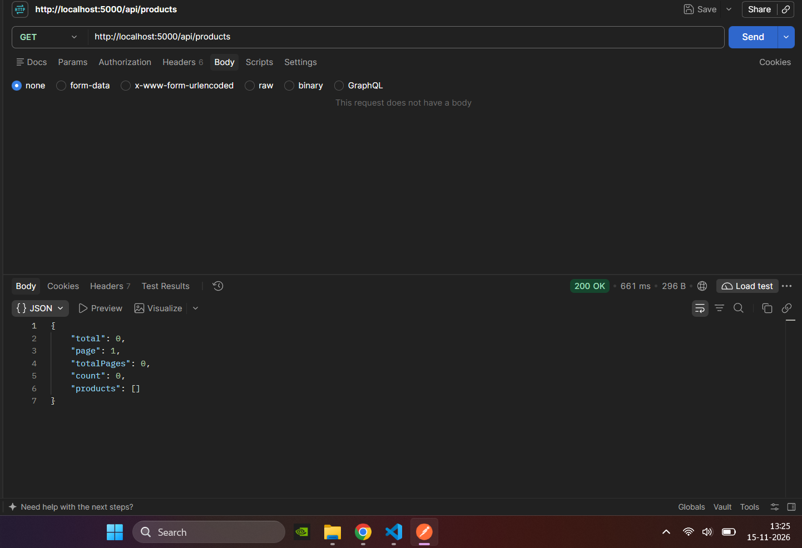
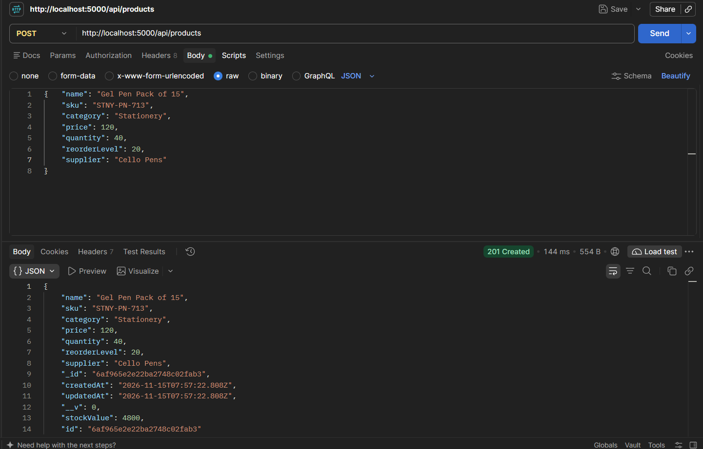
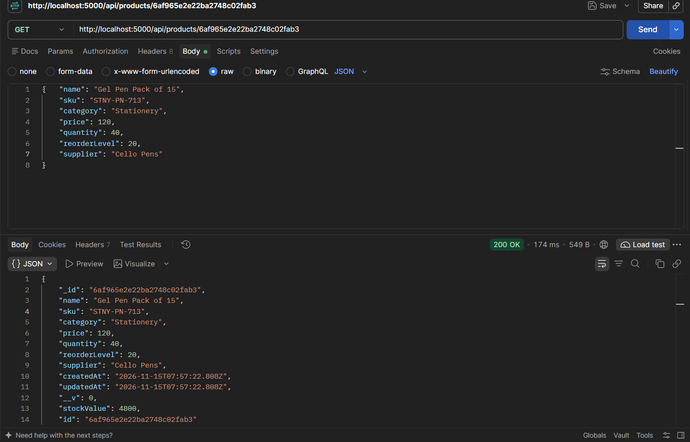
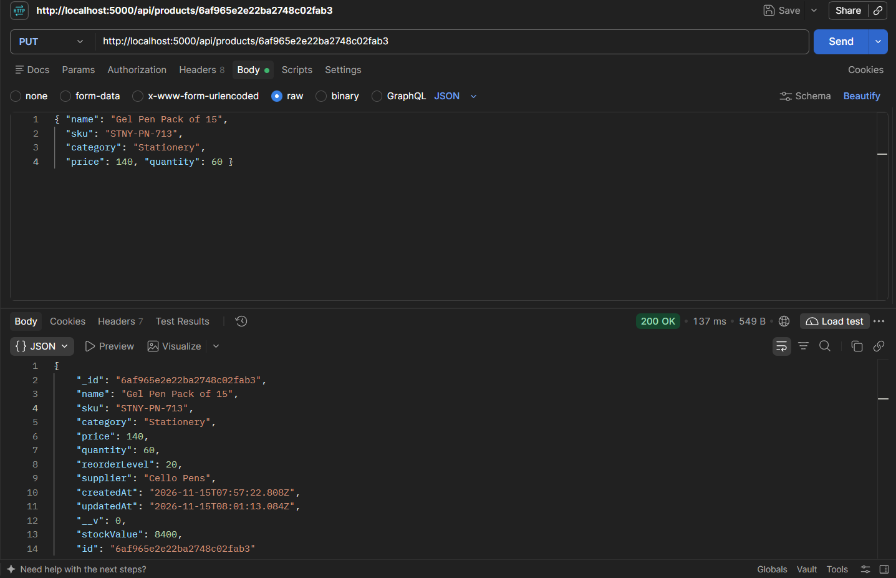
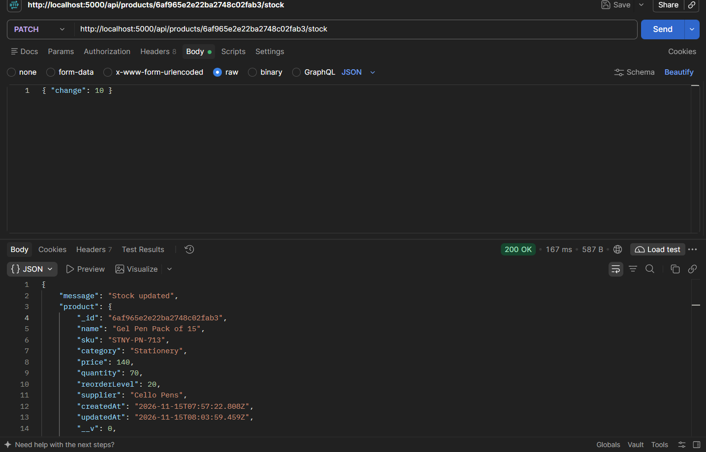
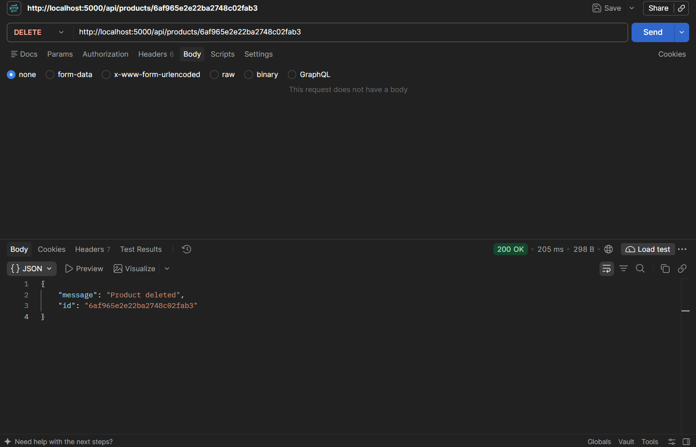
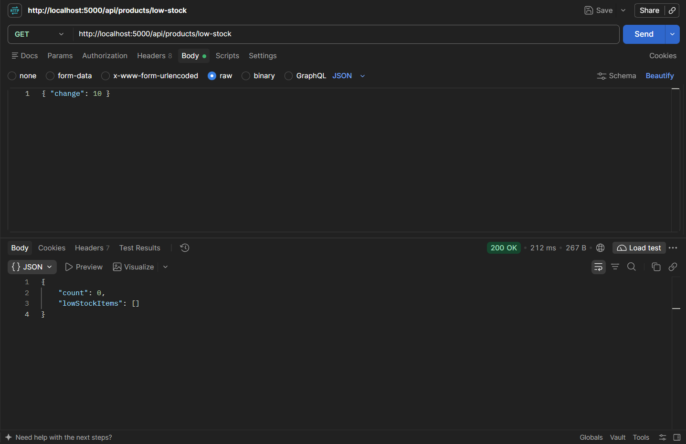
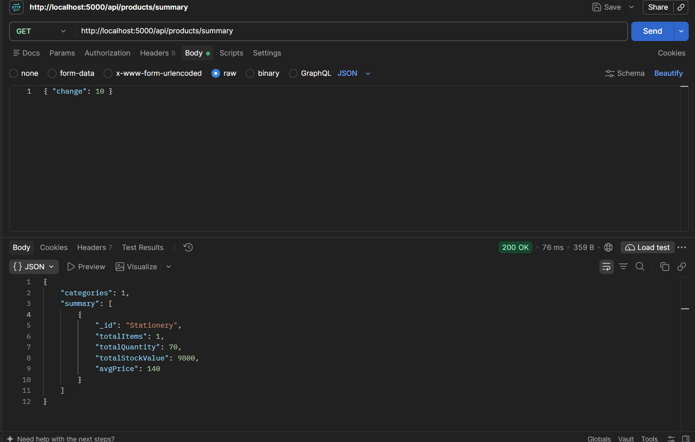
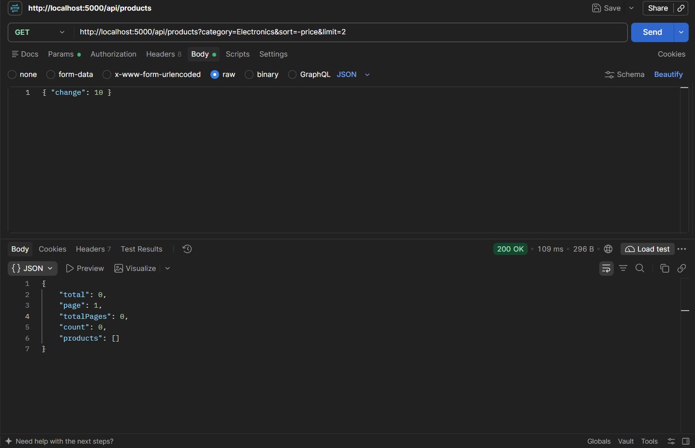
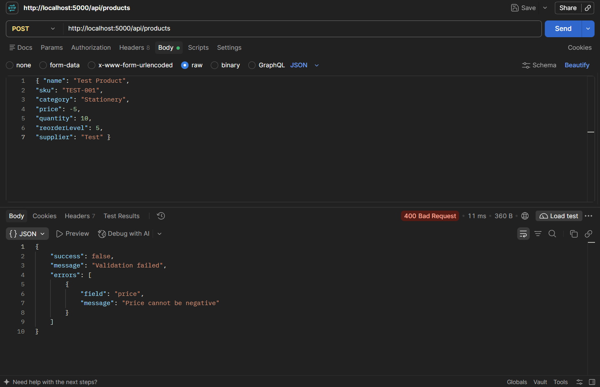

# Inventory and Data Management System

REST API for managing a store/warehouse product catalogue, built with **Node.js, Express.js, MongoDB (Mongoose) and dotenv**.

**Course:** Web Dev III | **Assignment:** 3 | **Unit:** 3 (CO3)

## Features
- Mongoose schema with field-level validation (required, min/max, unique + format-checked SKU, integer quantity)
- Virtual field `stockValue` (= price x quantity)
- Full CRUD for products
- Filtering, sorting and pagination via query string
- Safe stock adjustment (restock / sale) using one atomic `$inc` update - stock can never go below 0
- Aggregation pipelines: low-stock alert report and category-wise summary
- Centralized error handling + validation middleware
- Environment variables with dotenv

## Project Structure
```
server.js
scripts/seed.js            # optional sample data (12 products)
src/
  config/db.js             # MongoDB connection
  models/Product.js        # schema + validation
  controllers/productController.js
  routes/productRoutes.js
  middleware/validate.js   # id/body validation
  middleware/errorHandler.js
  utils/                   # AppError, asyncHandler
```

## Setup
```bash
git clone <your-repo-link>
cd inventory-management-system
npm install
cp .env.example .env      # then edit MONGO_URI if needed (local or MongoDB Atlas)
npm run seed              # optional - load sample data
npm start                 # or: npm run dev
```
Server runs on `http://localhost:5000`.

## API Endpoints

| Method | Endpoint | Description |
|--------|----------|-------------|
| POST | `/api/products` | Create a product |
| GET | `/api/products` | List products (filter, sort, paginate) |
| GET | `/api/products/:id` | Get a single product |
| PUT | `/api/products/:id` | Update product details |
| PATCH | `/api/products/:id/stock` | Adjust stock (`{"change": 10}` restock, `{"change": -5}` sale) |
| DELETE | `/api/products/:id` | Delete a product |
| GET | `/api/products/low-stock` | Products where `quantity <= reorderLevel` |
| GET | `/api/products/summary` | Category-wise inventory summary (aggregation) |

### Query parameters for `GET /api/products`
| Param | Example | Meaning |
|-------|---------|---------|
| `category` | `?category=Electronics` | Exact category (case-insensitive) |
| `supplier` | `?supplier=Cello Pens` | Exact supplier |
| `search` | `?search=pen` | Match in name or SKU |
| `minPrice` / `maxPrice` | `?minPrice=100&maxPrice=1000` | Price range |
| `inStock` | `?inStock=true` | Only products with quantity > 0 |
| `sort` | `?sort=-price,name` | Comma separated, `-` = descending |
| `page` / `limit` | `?page=2&limit=5` | Pagination (default 1 / 10, max limit 100) |

### Sample request bodies
```json
POST /api/products
{ "name": "Gel Pen Pack of 15", "sku": "STNY-PN-713", "category": "Stationery", "price": 120, "quantity": 40, "reorderLevel": 20, "supplier": "Cello Pens" }

PUT /api/products/:id
{ "name": "Gel Pen Pack of 15", "sku": "STNY-PN-713", "category": "Stationery", "price": 140, "quantity": 60 }

PATCH /api/products/:id/stock
{ "change": 10 }
```

### Error format
```json
{ "success": false, "message": "Validation failed", "errors": [{ "field": "price", "message": "Price cannot be negative" }] }
```
400 = validation / bad input, 404 = not found, 409 = duplicate SKU.

## Postman Screenshots

### 1. GET all products (pagination)


### 2. POST create product


### 3. GET single product by ID


### 4. PUT update product


### 5. PATCH stock adjustment


### 6. DELETE product


### 7. Low-stock report


### 8. Category summary (aggregation)


### 9. Filtering + sorting


### 10. Validation error


---
**Author:** Prashant Kanwal (Roll No. 2501730468), B.Tech CSE AIML, Section G
